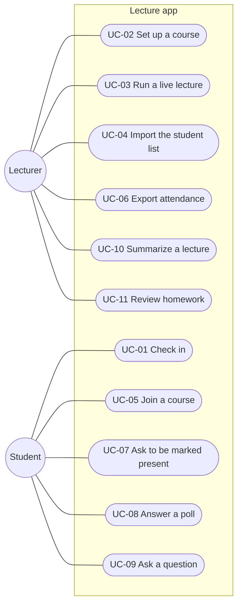

# Use cases (client stories)

These are the things lecturers and students do with the app, written as client stories. Each one links to the [requirements](SRS.md) it covers. The three most important ones are written out step by step: checking in, running a lecture, and joining a course.

