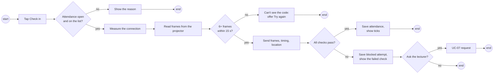

# Use cases (client stories)

These are the things lecturers and students do with the app, written as client stories. Each one links to the [requirements](SRS.md) it covers. The three most important ones are written out step by step: checking in, running a lecture, and joining a course.

## Client stories

| ID | Story | It works when... | Requirement |
| --- | --- | --- | --- |
| UC-01 | As a student in the room, I want to scan the code on the projector so I'm marked present in a few seconds. | Attendance is open and I'm on the list. I hold my phone on the code for about 2 seconds. Every check gets a tick and the count on the projector goes up by one. | REQ-05, REQ-06 |
| UC-02 | As a lecturer, I want to create a course and add a second lecturer so we can both run it. | The course gets a 6-character code. The second lecturer can plan lectures but can't delete the course. | REQ-02, REQ-15 |
| UC-03 | As a lecturer, I want to open attendance when I'm ready and run a second check later, so students who leave early only get partial. | When the second check starts, the first-round frames stop working and students have to scan again. | REQ-05, REQ-07, REQ-12 |
| UC-04 | As a lecturer, I want to import the Moodle student list once, so only my students can check in. | I drop in the Moodle file with Hebrew headers. The columns are recognised, duplicates and bad rows are reported, and no ID numbers are kept. | REQ-03 |
| UC-05 | As a new student, I want to join with the course code. | If I'm on the list I'm in right away. If not, the lecturer gets a request. | REQ-04 |
| UC-06 | As a lecturer, I want to download the attendance sheet in Excel to give to the department. | I get one row per student and a total percent. | REQ-08 |
| UC-07 | As a student whose phone failed, I want to ask the lecturer to mark me present, so I'm not marked absent unfairly. | The lecturer sees my reason, and only the lecturer can approve it. | REQ-09 |
| UC-08 | As a student, I want to answer the poll from my phone and see the results. | My vote is saved and I can change it until the poll closes. | REQ-10 |
| UC-09 | As a shy student, I want to ask without my name and upvote other questions, so the lecturer answers what most people want to know. | My question shows without my name, and the list is sorted by upvotes. | REQ-11 |
| UC-10 | As a lecturer, I want to paste the Zoom link after class and share an AI summary, so students can catch up. | With a Zoom transcript, the summary is ready in about a minute and I can share it. | REQ-13 |
| UC-11 | As a lecturer, I want an AI review of each homework and a warning about copied work. | I click Review all. Each student gets a score based on the assignment's requirements, and similar pairs are flagged. | REQ-14 |

## UC-01 Check in

**Who:** a student.
**Before:** the student is signed in and on the course list. The lecturer has started the lecture and opened attendance.
**After:** the student has an attendance record for this lecture. If the scan failed, a blocked attempt is saved with the reason.

1. The student taps **Check in**.
2. The camera opens and the server notes the time the scan began.
3. The phone measures its connection speed, so a slow network gets a little more time.
4. The student holds the phone on the projector. The phone reads at least 6 frames in about 2 seconds.
5. If the lecture checks location, the phone asks for it.
6. The phone sends the frames, their timing and the location to the database.
7. The database runs every check and saves the result.
8. The phone shows a tick for each check, and the count on the projector goes up.

**When something goes wrong**

- Attendance is paused or closed (step 2): the phone says so and stops.
- The student isn't on the list (step 2): "You are not on the list for this course".
- No code is seen for 15 seconds (step 4): "Can't see the code", with **Try again**.
- A check fails, for example a different network (step 7): the phone shows which check failed and offers **Try again** or **Ask the lecturer** (UC-07).
- The student already checked in this round (step 7): "Already checked in".

## UC-03 Run a live lecture

**Who:** a lecturer.
**Before:** the lecturer is signed in and teaches the course.
**After:** the lecture is over and attendance is saved. The slides are deleted from storage, and the files the lecturer chose to keep are shared with the class.

1. The lecturer opens the live room for a planned lecture, or clicks **Start now**.
2. The lecture starts, and the server saves the lecturer's network and location for the Wi-Fi and distance checks.
3. The lecturer clicks **Start attendance**. The projector shows the moving code and a live count.
4. Students check in (UC-01). The lecturer clicks **Stop**.
5. The lecturer shows slides or the whiteboard, runs polls (UC-08) and answers questions (UC-09).
6. The second check starts with the button, after N minutes, or at the set time. It closes by itself when its time runs out.
7. The lecturer clicks **End lecture** and chooses what to keep.
8. The kept files are shared, the slides are deleted from storage, and the lecture ends.

**Other paths**

- The lecturer pauses attendance: the code stops and scans are refused until **Resume**.
- The lecturer cancels a planned second check.
- Preparing the files takes more than 90 seconds: the lecturer is told and can try again.

## UC-05 Join a course

**Who:** a student.
**Before:** the student is signed in.
**After:** the student is in the course, or a request is waiting for the lecturer.

1. The student types the 6-character code on their home page.
2. The app finds the course.
3. The student is on the list, so they're in, and the course shows up on their shelf.

**Other paths**

- No course has this code: "No course with this code".
- The student isn't on the list: a request is sent, and the lecturer approves or declines it on the Requests page.
- The student already sent a request: the app says so.
